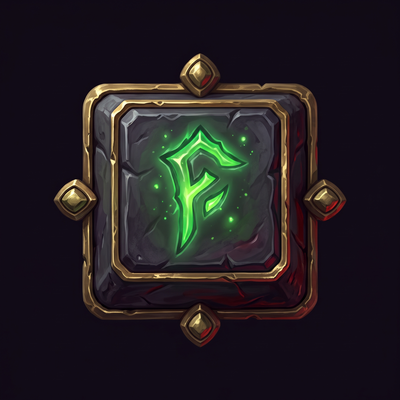
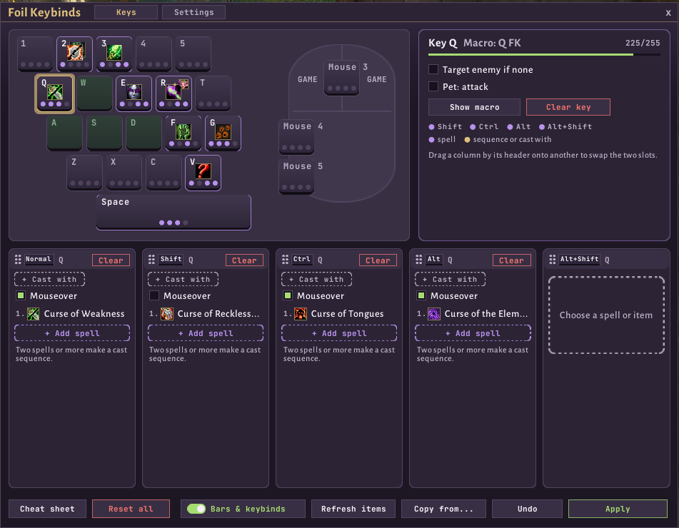
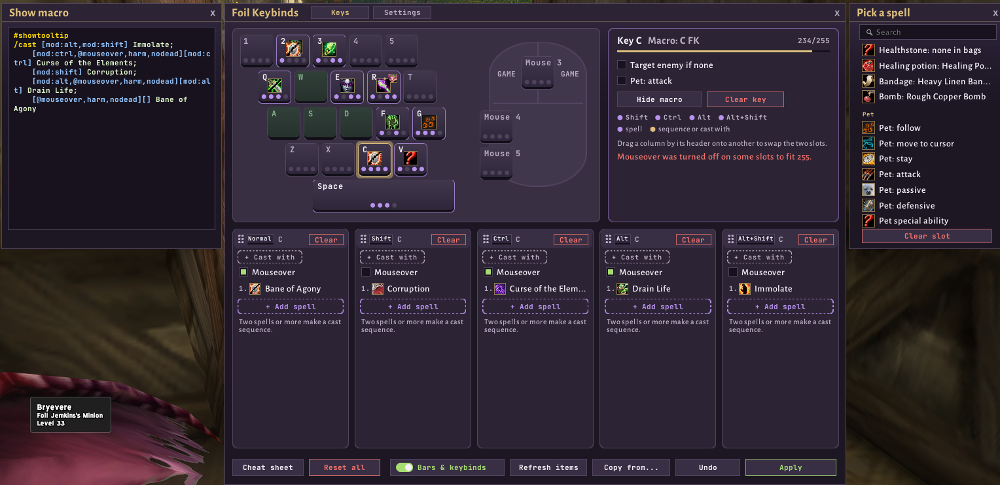
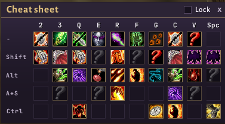
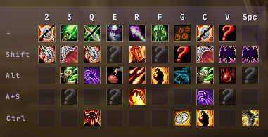
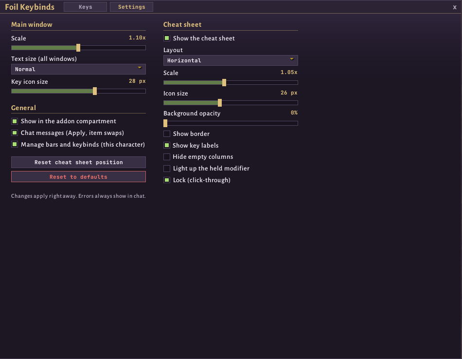
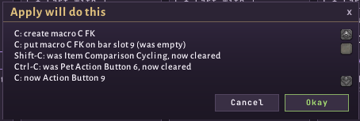

# Foil Keybinds

A WoW Forever addon that puts your whole layout on the keys near WASD. Each key gets one macro with five slots: normal, Shift, Alt, Alt+Shift and Ctrl. The modifiers live inside the macro, so one bar slot does it all.

## Screenshots

 

## What it does

- One macro per key, with the Shift, Alt, Alt+Shift and Ctrl variants inside it.
- Guide tab for all 9 classes (`/fkb guide`): the main abilities of your spec in rotation order, what each one is for and which key it is on, plus a ready-made layout for levels 1-19, 20-39 and 40-60. Every layout uses the same home keys: the rotation (a castsequence where it works) on Mouse 4, the wand or a second attack on Mouse 5, crowd control on E, DoTs on F and Q, big damage on R, items on V (see `docs/spec-v6.md`). Preview a layout, then Use it; Undo brings your own keys back. The guides are new; report a wrong key in the GitHub issues.
- Wizard for new players (`/fkb wizard`, or the "Build my layout" tile on the Guide tab): it walks through the guide layout of your spec one meaning at a time (main attack, crowd control, items...) and you click the key you want for each group. The last page lists every key with the macro Apply will write. It opens once by itself on the first `/fkb` with no keys, and remembers your picks for the next level range.
- QoL item buttons: Heal button (health potion in combat, bandage out of combat), Eat and drink (best food and water in one click), Healthstone or potion. The guide layouts put them on V, Shift+V and Alt+V.
- Layouts menu: save your keys under a name; load, overwrite, rename or delete a saved layout; or copy the keys of another character of your class. Before a layout, a copy or an Undo replaces your keys, they are saved there automatically (the last 10).
- Canvas editor: click a key, pick a learned spell or a consumable for each slot. Drag a key onto another key to swap them (all five slots), or a column onto another column to swap two slots.
- Items: potions, Healthstone, bombs and bandages use the best one in your bags.
- Places each macro on the bar slot the key already presses and clears the modifier bindings that would block it.
- Future spells: with [What's Training](https://github.com/fusionpit/WhatsTraining) installed, the picker also lists spells you have not learned yet, with the level you get them.
- Cheat sheet: a small floating view of what is live, as rows (one row per applied key, one column per modifier) or as a mini keyboard (keys where the canvas has them, the normal icon large and the 4 modifier icons small). What the modifier you hold fires lights up. Drag it, scroll to resize, lock it to make it click-through in combat.
- Settings: window scale, text size, key icon size; cheat sheet layout, scale, icon size, background opacity (0% leaves only the icons), border, key labels, hide empty columns, modifier highlight, lock; addon compartment entry, chat messages, reset to defaults, reset the cheat sheet position. Every change shows right away.
- Login repair: renamed or removed spells are fixed once on login, with a popup that lists the changes and can undo them.

## How to use

Type `/fkb` (or left click the addon compartment entry) to open the editor. Set your keys, then click Apply. Undo takes back your last edit, one step per click. Reset all puts back what the first Apply changed (bindings, bar slots and macros); your key setups stay.

Commands: `/fkb`, `/fkb set Q Shadow Bolt`, `/fkb apply`, `/fkb undo` (one edit back), `/fkb reset` (Reset all), `/fkb cheat` (or `/fkb cola`) to show or hide the cheat sheet, `/fkb guide` (or `/fkb guia`) for the class guide and ready-made layouts, `/fkb wizard` (or `/fkb assistente`) for the wizard, `/fkb config` (or `/fkb settings`, `/fkb opcoes`) for the settings.

Settings also open from the gear in the editor's title bar, a right click on the compartment entry, and Options > AddOns > Foil Keybinds. They are account-wide; the cheat sheet position and whether it is shown stay per character.

## Limits

- WoW Forever (retail) only.
- A macro holds at most 255 characters, so very long spell names on all five slots may not fit.
- Apply works out of combat only (WoW blocks macro and binding changes in combat).
- Bindings follow the game's binding mode (account-wide or per character), whichever is active when you Apply.
- Bar slots are found from the main bar page; stance and bonus bar paging (forms, stealth) is not followed.
- A key with no normal slot keeps its own binding (Space still jumps). The macro goes on a free bar slot (empty, no key bound) so its cooldown shows, and the used Shift/Alt/Alt+Shift/Ctrl variants press that slot. With no free slot, they are bound to the macro directly (no cooldown on a bar).
- Items are matched by item ID. With none in your bags the macro falls back to the English item name, which only works on English clients.
- Characters have a limited number of macro slots (about 18); keys that do not fit are skipped with a chat message.

## Development

Tests need LuaJIT (Lua 5.1): `winget install --id DEVCOM.LuaJIT -e`

    luajit tests/run.lua

Install for in-game testing:

    sh install.sh

Releases are built by `.github/workflows/release.yml` on a `v*` tag. See `docs/publishing.md`.

## License

MIT, see `LICENSE`. Future spell data comes from the optional addon What's Training (MIT, by fusionpit) through its public `WT_API`.
